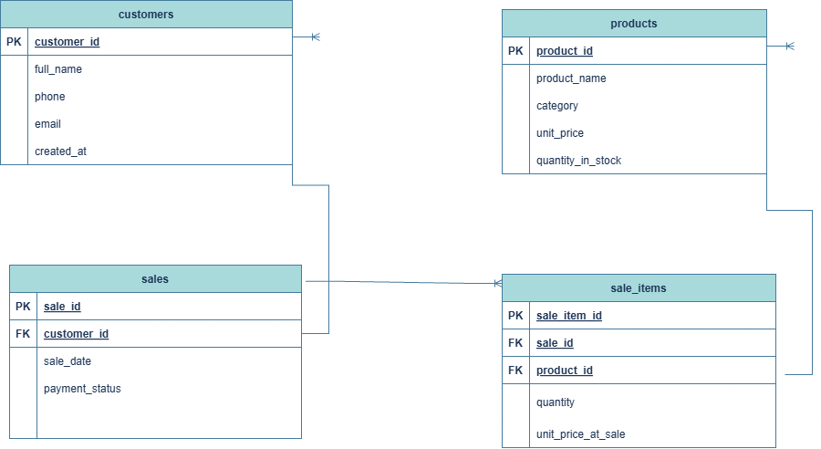

# Portfolio 1: Database Design and Modelling

## 1. Case Study: Abitim Farms Management System

### Scenario & Business Context
Abitim Farms is a commercial farming business specializing in poultry products (eggs, live birds, processed meat) and animal feed. To streamline operations, reduce data redundancy, and improve sales and inventory tracking, the business requires a relational database system managed via PostgreSQL.

### System Users
* **Sales / Checkout Staff:** Record customer purchases and issue transactions.
* **Inventory Managers:** Update product details, restock feed and poultry supplies, and track stock levels.
* **Farm Management / Admin:** Retrieve sales reports, analyze revenue, and audit customer records.

### Key Database Operations Supported
1. Registering new customer details.
2. Creating sales transactions and linking them to specific customers.
3. Adding multiple line items (products, quantities, historical prices) to a single transaction.
4. Managing product catalogs and tracking `quantity_in_stock`.

---

## 2. Entity Relationship Diagram (ERD)

### Relationships
* **CUSTOMERS to SALES (1 : N):** A customer can place many sales transactions, but each sale belongs to exactly one customer.
* **SALES to SALE_ITEMS (1 : N):** A sale can contain multiple line items, but each item entry belongs to one specific sale.
* **PRODUCTS to SALE_ITEMS (1 : N):** A product can appear in multiple sale items across different sales, but each sale item references only one product.

---

## 3. Relational Schema

CUSTOMERS (
    customer_id INTEGER GENERATED ALWAYS AS IDENTITY PRIMARY KEY,
    full_name VARCHAR(100) NOT NULL,
    phone VARCHAR(20) UNIQUE,
    email VARCHAR(150) UNIQUE,
    created_at TIMESTAMP DEFAULT CURRENT_TIMESTAMP
)

PRODUCTS (
    product_id INTEGER GENERATED ALWAYS AS IDENTITY PRIMARY KEY,
    product_name VARCHAR(100) NOT NULL UNIQUE,
    category VARCHAR(30) NOT NULL
        CHECK (category IN ('eggs', 'poultry', 'feed', 'other')),
    unit_price NUMERIC(12, 2) NOT NULL
        CHECK (unit_price >= 0),
    quantity_in_stock INTEGER NOT NULL DEFAULT 0
        CHECK (quantity_in_stock >= 0)
)

SALES (
    sale_id INTEGER GENERATED ALWAYS AS IDENTITY PRIMARY KEY,
    customer_id INTEGER NOT NULL
        REFERENCES CUSTOMERS(customer_id),
    sale_date TIMESTAMP NOT NULL DEFAULT CURRENT_TIMESTAMP,
    payment_status VARCHAR(20) NOT NULL DEFAULT 'pending'
        CHECK (payment_status IN ('pending', 'paid', 'cancelled'))
)

SALE_ITEMS (
    sale_item_id INTEGER GENERATED ALWAYS AS IDENTITY PRIMARY KEY,
    sale_id INTEGER NOT NULL
        REFERENCES SALES(sale_id) ON DELETE CASCADE,
    product_id INTEGER NOT NULL
        REFERENCES PRODUCTS(product_id),
    quantity INTEGER NOT NULL CHECK (quantity > 0),
    unit_price_at_sale NUMERIC(12, 2) NOT NULL
        CHECK (unit_price_at_sale >= 0)
)

## 4. Keys and Constraints

### Primary Keys
Primary keys uniquely identify every row in a table.
* `CUSTOMERS.customer_id`
* `PRODUCTS.product_id`
* `SALES.sale_id`
* `SALE_ITEMS.sale_item_id`

### Foreign Keys
Foreign keys enforce referential integrity between related entities.
* `SALES.customer_id` references `CUSTOMERS.customer_id`
* `SALE_ITEMS.sale_id` references `SALES.sale_id`
* `SALE_ITEMS.product_id` references `PRODUCTS.product_id`

### Additional Constraints
* **NOT NULL:** Ensures required information cannot be left empty, such as full_name, product_name, category, unit_price, quantity_in_stock, customer_id, and quantity.
* **UNIQUE:** Prevents duplicate values where uniqueness is required, including customer phone, customer email, and product_name.
* **CHECK:** Restricts values according to business rules. For example, quantity must be greater than zero, prices cannot be negative, stock cannot be negative, product categories must be one of the permitted categories, and payment status must be pending, paid, or cancelled.
* **DEFAULT:** Automatically provides values where appropriate. For example, CURRENT_TIMESTAMP records creation/sale time, quantity_in_stock defaults to 0, and payment_status defaults to pending.

* **ON DELETE CASCADE:** Ensures that when a sale is deleted, its associated records in sale_items are also removed, preventing orphaned sale-item records.
---

