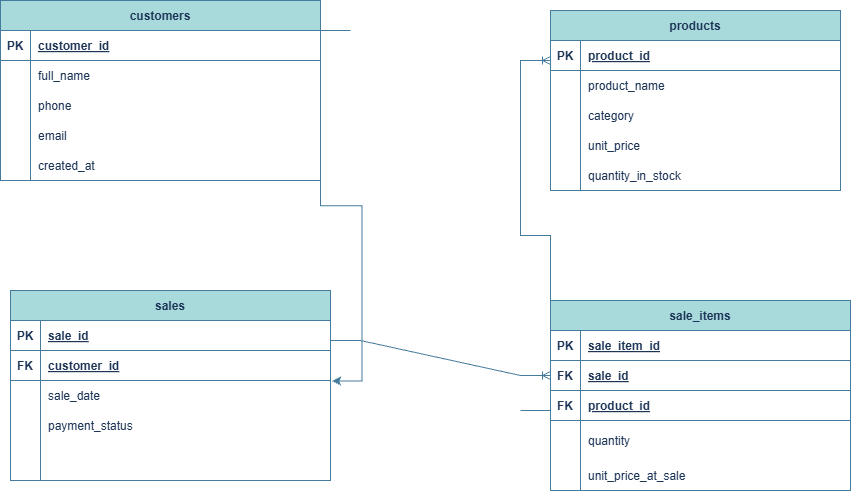

# Portfolio 1: Database Design and Modelling

## 1. Case Study: Abitim Farms Management System

### Scenario & Business Context
Abitim Farms is a commercial farming business specializing in poultry products (eggs, live birds, processed meat) and animal feed. To streamline operations, reduce data redundancy, and improve sales and inventory tracking, the business requires a relational database system managed via PostgreSQL.

### System Users
* **Sales / Checkout Staff:** Record customer purchases and issue transactions.
* **Inventory Managers:** Update product details, restock feed and poultry supplies, and track stock levels.
* **Farm Management / Admin:** Retrieve sales reports, analyze revenue, and audit customer records.

### Key Database Operations Supported
1. Registering new customer details.
2. Creating sales transactions and linking them to specific customers.
3. Adding multiple line items (products, quantities, historical prices) to a single transaction.
4. Managing product catalogs and tracking `quantity_in_stock`.

---

## 2. Entity Relationship Diagram (ERD)



### Relationships
* **CUSTOMERS to SALES (1 : N):** A customer can place many sales transactions, but each sale belongs to exactly one customer.
* **SALES to SALE_ITEMS (1 : N):** A sale can contain multiple line items, but each item entry belongs to one specific sale.
* **PRODUCTS to SALE_ITEMS (1 : N):** A product can appear in multiple sale items across different sales, but each sale item references only one product.

---


## 3. Relational Schema

```text
CUSTOMERS (
    customer_id INTEGER GENERATED ALWAYS AS IDENTITY PRIMARY KEY,
    full_name VARCHAR(100) NOT NULL,
    phone VARCHAR(20) UNIQUE,
    email VARCHAR(150) UNIQUE,
    created_at TIMESTAMP DEFAULT CURRENT_TIMESTAMP
)

PRODUCTS (
    product_id INTEGER GENERATED ALWAYS AS IDENTITY PRIMARY KEY,
    product_name VARCHAR(100) NOT NULL UNIQUE,
    category VARCHAR(30) NOT NULL
        CHECK (category IN ('eggs', 'poultry', 'feed', 'other')),
    unit_price NUMERIC(12, 2) NOT NULL
        CHECK (unit_price >= 0),
    quantity_in_stock INTEGER NOT NULL DEFAULT 0
        CHECK (quantity_in_stock >= 0)
)

SALES (
    sale_id INTEGER GENERATED ALWAYS AS IDENTITY PRIMARY KEY,
    customer_id INTEGER NOT NULL
        REFERENCES CUSTOMERS(customer_id),
    sale_date TIMESTAMP NOT NULL DEFAULT CURRENT_TIMESTAMP,
    payment_status VARCHAR(20) NOT NULL DEFAULT 'pending'
        CHECK (payment_status IN ('pending', 'paid', 'cancelled'))
)

SALE_ITEMS (
    sale_item_id INTEGER GENERATED ALWAYS AS IDENTITY PRIMARY KEY,
    sale_id INTEGER NOT NULL
        REFERENCES SALES(sale_id) ON DELETE CASCADE,
    product_id INTEGER NOT NULL
        REFERENCES PRODUCTS(product_id),
    quantity INTEGER NOT NULL CHECK (quantity > 0),
    unit_price_at_sale NUMERIC(12, 2) NOT NULL
        CHECK (unit_price_at_sale >= 0)
)
```
## 4. Keys and Constraints

### Primary Keys
Primary keys uniquely identify every row in a table.
* `CUSTOMERS.customer_id`
* `PRODUCTS.product_id`
* `SALES.sale_id`
* `SALE_ITEMS.sale_item_id`

### Foreign Keys
Foreign keys enforce referential integrity between related entities.
* `SALES.customer_id` references `CUSTOMERS.customer_id`
* `SALE_ITEMS.sale_id` references `SALES.sale_id`
* `SALE_ITEMS.product_id` references `PRODUCTS.product_id`

### Additional Constraints
* **NOT NULL:** Ensures required information cannot be left empty, such as full_name, product_name, category, unit_price, quantity_in_stock, customer_id, and quantity.
* **UNIQUE:** Prevents duplicate values where uniqueness is required, including customer phone, customer email, and product_name.
* **CHECK:** Restricts values according to business rules. For example, quantity must be greater than zero, prices cannot be negative, stock cannot be negative, product categories must be one of the permitted categories, and payment status must be pending, paid, or cancelled.
* **DEFAULT:** Automatically provides values where appropriate. For example, CURRENT_TIMESTAMP records creation/sale time, quantity_in_stock defaults to 0, and payment_status defaults to pending.

* **ON DELETE CASCADE:** Ensures that when a sale is deleted, its associated records in sale_items are also removed, preventing orphaned sale-item records.
---

## 5. Normalisation

The Abitim Farms database was normalised to reduce data redundancy, improve data consistency, and ensure that information is stored in appropriate related tables. The database design follows the First, Second, and Third Normal Forms (1NF, 2NF, and 3NF).

### 5.1 First Normal Form (1NF)

First Normal Form requires each table to have a primary key and each field to contain a single, atomic value rather than multiple values in one field.

The Abitim Farms database satisfies 1NF because each table has a primary key and each column stores a single value. For example, customer details such as `full_name`, `phone`, and `email` are stored in separate columns rather than being combined into one field.

Similarly, products purchased in a sale are not stored as a list inside the `SALES` table. Instead, each product purchased is represented as a separate record in the `SALE_ITEMS` table.

Therefore, the tables contain atomic values and do not contain repeating groups.

### 5.2 Second Normal Form (2NF)

Second Normal Form requires a table to already be in 1NF and for every non-prime attribute (an attribute that belongs to no candidate key) to depend on the whole of every candidate key. There must be no partial dependencies on part of a composite candidate key.

In the final Abitim Farms design, all candidate keys identified by the stated business rules are single-column keys, including the primary keys and the unique, required `product_name`. Therefore, there are no composite candidate keys on which partial dependencies could occur. The nullable unique customer phone and email columns are optional identifiers rather than candidate keys for every row.

Customer information such as `full_name`, `phone`, and `email` is stored only in the `CUSTOMERS` table and depends on `customer_id`. Product information such as `product_name`, `category`, `unit_price`, and `quantity_in_stock` is stored in the `PRODUCTS` table and depends on `product_id`.

Sales information such as `sale_date` and `payment_status` depends on `sale_id`, while the details of individual items sold are stored separately in `SALE_ITEMS`.

This structure prevents customer or product information from being unnecessarily repeated for every sales transaction.

### 5.3 Third Normal Form (3NF)

Third Normal Form requires a table to already satisfy 2NF and ensures that non-key attributes depend on the primary key rather than on other non-key attributes.

The Abitim Farms database satisfies 3NF because attributes relating to customers, products, sales, and sale items are stored in their respective tables.

For example, customer contact information is not stored in the `SALES` table. Instead, `SALES` contains `customer_id` as a foreign key referencing the `CUSTOMERS` table. Similarly, product details such as `product_name` and `category` are not repeated in `SALE_ITEMS`. The `product_id` foreign key is used to reference the corresponding product.

This design reduces data duplication and helps prevent update, insertion, and deletion anomalies.

### 5.4 Functional Dependencies

Functional dependencies describe how one attribute determines other attributes within a relation. In the Abitim Farms database, the main functional dependencies are:

- `customer_id → full_name, phone, email, created_at`
- `product_id → product_name, category, unit_price, quantity_in_stock`
- `sale_id → customer_id, sale_date, payment_status`
- `sale_item_id → sale_id, product_id, quantity, unit_price_at_sale`

For example, once a `customer_id` is known, the corresponding customer's name, phone number, email address, and creation date can be identified. These attributes are therefore dependent on the `customer_id`.

The separation of these dependencies into their appropriate tables helps ensure that non-key attributes depend on their respective primary keys.

### 5.5 Example of Normalisation to 3NF

Consider an unnormalised sales record with a repeating group of purchased products:

`SaleID, SaleDate, CustomerID, CustomerName, CustomerPhone, {ProductID, ProductName, CurrentProductPrice, Quantity, UnitPriceAtSale}`

For this worked example only, assume each product appears at most once in a sale. After flattening the repeating group, `(SaleID, ProductID)` is a composite candidate key. The implemented database instead uses `sale_item_id` and permits separate lines for the same product in a sale.

**1NF:** Store one row per product per sale, with a single value in each field:

`SALE_DETAILS(SaleID, ProductID, SaleDate, CustomerID, CustomerName, CustomerPhone, ProductName, CurrentProductPrice, Quantity, UnitPriceAtSale)`

**2NF:** Remove partial dependencies on the composite key. `SaleDate`, `CustomerID`, `CustomerName`, and `CustomerPhone` depend only on `SaleID`; `ProductName` and `CurrentProductPrice` depend only on `ProductID`. `Quantity` and `UnitPriceAtSale` depend on the complete `(SaleID, ProductID)` key under the example's assumption. Decompose the relation into:

- `SALES_2NF(SaleID, SaleDate, CustomerID, CustomerName, CustomerPhone)`
- `PRODUCTS(ProductID, ProductName, CurrentProductPrice)`
- `SALE_ITEMS(SaleID, ProductID, Quantity, UnitPriceAtSale)`

**3NF:** Remove the transitive dependency `SaleID → CustomerID → CustomerName, CustomerPhone` from `SALES_2NF`. Customer contact details depend on the customer, so separate them into:

- `CUSTOMERS(CustomerID, CustomerName, CustomerPhone)`
- `SALES(SaleID, SaleDate, CustomerID)`

`PRODUCTS` and `SALE_ITEMS` already satisfy 3NF under the dependencies stated for this example. The final schema adds the remaining documented attributes and uses `sale_item_id` as the primary key of `SALE_ITEMS`. `CurrentProductPrice` maps to `PRODUCTS.unit_price`, while `UnitPriceAtSale` maps to `SALE_ITEMS.unit_price_at_sale`.

This progression distinguishes removal of partial dependencies in 2NF from removal of transitive dependencies in 3NF, reducing redundancy and helping prevent insertion, update, and deletion anomalies.

### 5.6 Historical Sale Price

Although the `PRODUCTS` table contains `unit_price`, the `SALE_ITEMS` table also contains `unit_price_at_sale`. This is intentional rather than unnecessary duplication.

`PRODUCTS.unit_price` represents the product's current selling price, while `SALE_ITEMS.unit_price_at_sale` records the actual price charged when a particular transaction occurred.

For example, if a crate of eggs was sold for ₦4,500 and its current price later changes to ₦5,000, the historical sale should still show that the customer paid ₦4,500. Storing `unit_price_at_sale` therefore preserves the accuracy of historical sales records.

The use of primary keys and foreign keys connects these tables without unnecessarily duplicating customer, product, or sales information. Under the stated functional dependencies, the resulting design satisfies 1NF, 2NF, and 3NF and provides a structured relational model for the Abitim Farms Management System.


## AI Use Declaration

- **AI Tools Used:** ChatGPT / Gemini and OpenAI Codex
- **Purpose:** AI tools were used as learning aids for guidance on database concepts, formatting assistance, refining normalisation explanations, and structuring technical documentation.
- **Verification:** The SQL queries and database structures were reviewed and tested in PostgreSQL using pgAdmin. Query outputs, table relationships, primary and foreign keys, constraints, and the ER diagram were checked against the implemented database, and identified errors were corrected before inclusion in the portfolio.